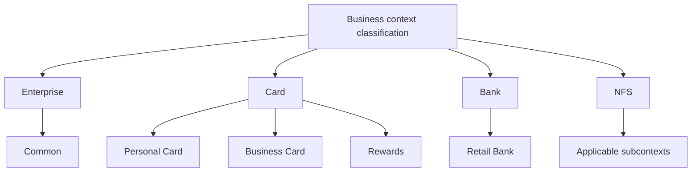
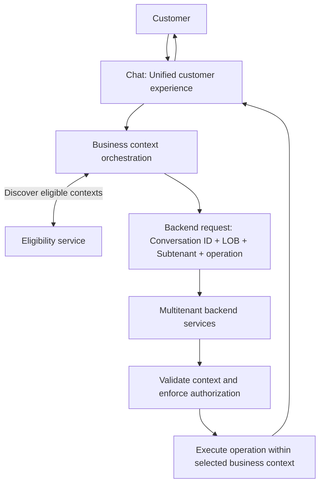
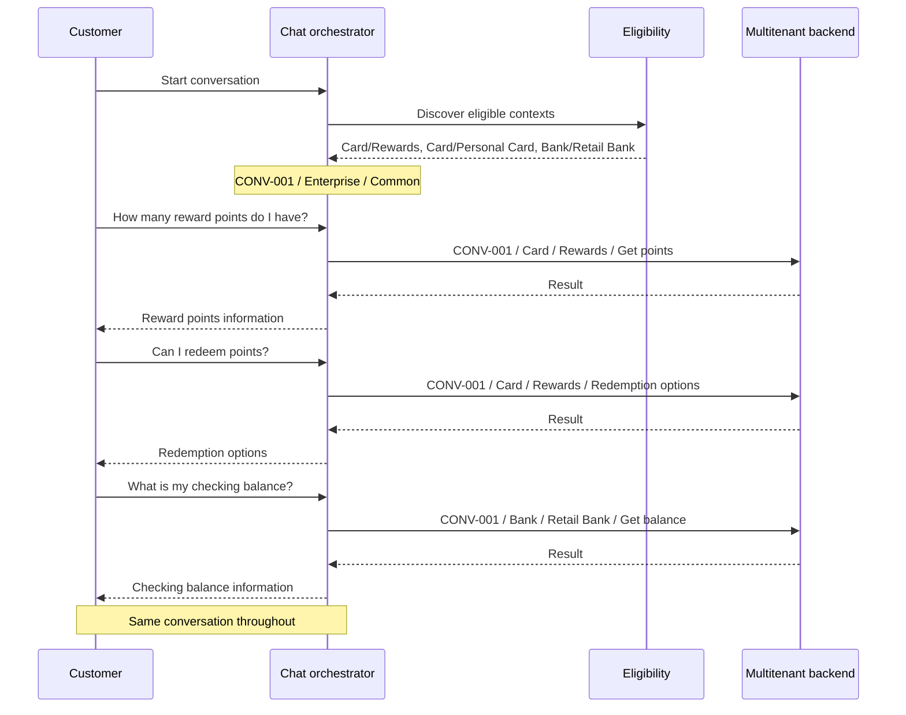
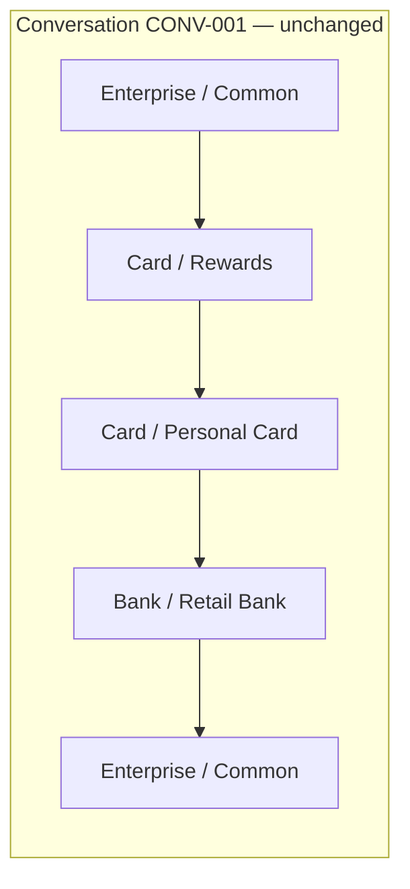

# Chat as a Dynamic Business Context Orchestrator

## 1. Context and purpose

In a banking environment, the Chat available on the bank's website is a unified, customer-facing entry point. Customers interact with the bank through a single conversation, regardless of the product, service, or line of business involved in their request.

Behind this experience, backend services operate in a multitenant environment capable of serving different lines of business and their respective business contexts.

A customer may begin by asking a general question, continue with a credit card rewards inquiry, and then ask about a checking account. Although these needs belong to different business contexts, the customer should be able to address all of them within the same conversation.

The proposed model positions Chat as a **dynamic business context orchestrator** that identifies the customer's current need, determines the appropriate eligible business context, and communicates that context to the backend with each request.

The customer expresses a need. Chat determines the context in which that need should be addressed. The multitenant backend processes the request within that context.

## 2. Backend multitenancy

Backend multitenancy is the ability of backend services to support multiple business contexts while preserving the boundaries and behavior associated with each context.

In this model, a Tenant represents a line of business (LOB), and a Subtenant represents a more specific context within that line of business. A backend service may support several such contexts; not every service necessarily supports every Tenant or Subtenant.

For example, a backend service capable of supporting both Card and Bank can receive requests associated with either context. The Tenant and Subtenant supplied with each request identify the business scope within which that operation must be executed.

This means that the business context is a property of the **individual request**, rather than a permanent property of the customer or conversation.

The backend uses the validated context to determine the applicable business rules, configuration, data scope, and processing behavior. It remains responsible for enforcing authorization and tenant isolation. The context selected by Chat is not, by itself, proof of authorization.

Multitenancy does not necessarily imply a separate service deployment or database for every LOB or Subtenant. The proposal describes logical business boundaries, not a particular physical deployment or data isolation implementation.

## 3. Tenant and Subtenant classification

The following terminology is used throughout this proposal:

| Attribute | Meaning |
|---|---|
| Tenant / LOB | The line of business or general enterprise context responsible for the request. |
| Subtenant / Sub-LOB | A specific business context within the selected Tenant. |
| Conversation ID | The identifier of the ongoing customer conversation, independent of the active Tenant and Subtenant. |

An illustrative classification is:

| Tenant / LOB | Subtenant / Sub-LOB |
|---|---|
| Enterprise | Common |
| Card | Personal Card |
| Card | Business Card |
| Card | Rewards |
| Bank | Retail Bank |
| NFS | Applicable NFS subcontexts |



Enterprise / Common is the default general context when no more specific business need has been established. It is not intended to grant unrestricted access to other business contexts.

The classification above is illustrative. The exact LOB names and Subtenant boundaries should reflect the bank's actual business model. The model is not intended to imply that every product or capability is formally classified as a Sub-LOB by the enterprise.

## 4. Chat as a business context orchestrator

Chat is more than a communication interface. It is responsible for orchestrating the customer interaction across the business contexts supported by the backend.

When a customer expresses a need, Chat identifies the intent and determines which line of business and Subtenant are appropriate for that need, based on the customer's eligible options.

For example, a question about credit card reward points may resolve to Card / Rewards, while a question about a checking account may resolve to Bank / Retail Bank.

Once the appropriate context has been established, Chat includes the Tenant and Subtenant attributes in the requests it sends to the backend. These attributes remain consistent throughout the corresponding business subflow, unless the customer's need changes and a different context must be resolved.

Chat is responsible for:

- Identifying the customer's intent and business need.
- Discovering which business contexts are available to the customer through Eligibility.
- Selecting the appropriate Tenant and Subtenant from the eligible options.
- Maintaining the active context throughout a business subflow.
- Propagating the context with each backend request.
- Re-evaluating and switching context when the customer's need changes.
- Maintaining the continuity of the customer conversation across those changes.

Chat does not own tenant-specific business processing or act as the final authority for backend authorization. The backend is responsible for those concerns.

In this proposal, Chat refers to the customer-facing Chat experience and its supporting orchestration capabilities. It does not imply that sensitive orchestration decisions must be implemented exclusively in the browser or in the presentation layer.

## 5. Eligibility as a context discovery mechanism

Chat interacts with an Eligibility service to discover the business contexts that are potentially available to the customer.

The service may return one or several eligible Tenant and Subtenant combinations based on the customer's existing relationships, products, and applicable eligibility rules.

For example, a particular customer might receive the following eligible contexts:

| Tenant | Subtenant |
|---|---|
| Card | Personal Card |
| Card | Rewards |
| Bank | Retail Bank |

In this example, Business Card and NFS are not returned as eligible options. Chat should not select them as contexts for serving this customer's requests based on this eligibility result.

Eligibility establishes the set of potential contexts. Customer intent determines which of those contexts is relevant at a particular point in the conversation.

If the customer's intent is ambiguous, Chat needs to resolve that ambiguity before selecting a specific context. Eligibility alone does not determine what the customer wants, and customer intent alone does not establish eligibility.

**Eligibility identifies the available options; Chat selects the relevant option; the backend validates and executes the operation.**

## 6. Request-level business context

Each backend request includes the attributes necessary to identify the business context of that specific operation:

- Conversation ID, to correlate the request with the ongoing conversation.
- Tenant / LOB, to identify the relevant line of business.
- Subtenant / Sub-LOB, to identify the specific business context.
- The operation-specific input required by the backend service.

The context attributes may be conveyed in request headers or the request body, depending on the integration contract. The architectural principle is that the context is explicitly communicated with each request; the specific transport representation is not prescribed.

For example, a request to retrieve reward points could be represented as follows:

```http
POST /illustrative-service
X-Conversation-Id: CONV-001
X-Tenant: Card
X-Subtenant: Rewards
Content-Type: application/json

{
  "operation": "Get reward points"
}
```

When the customer subsequently asks about a checking account, Chat sends the next request using the newly resolved context:

```http
POST /illustrative-service
X-Conversation-Id: CONV-001
X-Tenant: Bank
X-Subtenant: Retail Bank
Content-Type: application/json

{
  "operation": "Get checking account balance"
}
```

An alternative representation could include the context in the request body:

```json
{
  "conversationId": "CONV-001",
  "tenant": "Bank",
  "subtenant": "Retail Bank",
  "operation": "Get checking account balance"
}
```

These examples are conceptual and do not define actual API endpoints, header names, schemas, or authentication mechanisms. The important distinction is that the Conversation ID remains unchanged while the Tenant, Subtenant, and operation can change.

## 7. Example: one conversation across multiple business contexts

Consider a customer who starts a conversation and has access to Personal Card, Rewards, and Retail Bank contexts.

### Step 1 — Start the conversation

**Customer:** "Hi, I need help with my accounts."

No specific business need has been identified yet. Chat initializes the conversation under the general Enterprise / Common context and discovers the customer's eligible options.

- Conversation ID: CONV-001
- Tenant: Enterprise
- Subtenant: Common

### Step 2 — Ask about credit card rewards

**Customer:** "How many credit card reward points do I have?"

Chat recognizes a rewards-related intent and determines that Card / Rewards is one of the customer's eligible contexts. It switches the active context and sends the request to the appropriate backend service.

- Conversation ID: CONV-001
- Tenant: Card
- Subtenant: Rewards

Both the Tenant and Subtenant change, but the conversation remains the same.

### Step 3 — Continue within the rewards subflow

**Customer:** "Can I redeem some of those points?"

The customer is expressing a new operation within the same business need. Chat continues using Card / Rewards for the backend calls associated with this subflow.

- Conversation ID: CONV-001
- Tenant: Card
- Subtenant: Rewards

Neither the Tenant nor the Subtenant changes. The operation changes, but the business context remains the same.

### Step 4 — Ask about a personal credit card payment

**Customer:** "When is my credit card payment due?"

Chat recognizes that the customer has moved from rewards to credit card account servicing. It selects Card / Personal Card from the eligible options.

- Conversation ID: CONV-001
- Tenant: Card
- Subtenant: Personal Card

The LOB remains Card, but the Subtenant changes from Rewards to Personal Card.

### Step 5 — Ask about a checking account

**Customer:** "What is my checking account balance?"

The customer introduces a different business need. Chat resolves the intent to Bank / Retail Bank and sends subsequent requests with that context.

- Conversation ID: CONV-001
- Tenant: Bank
- Subtenant: Retail Bank

Both the Tenant and Subtenant change. The customer does not need to start another conversation.

### Step 6 — Continue within the retail banking subflow

**Customer:** "Can you show me my recent checking account transactions?"

Chat retains Bank / Retail Bank because the request belongs to the same business context, even if a different backend operation or service is involved.

- Conversation ID: CONV-001
- Tenant: Bank
- Subtenant: Retail Bank

Neither context attribute changes.

### Step 7 — Return to general assistance

**Customer:** "Thanks. I need help with something else."

If the previous subflow has ended and no new specific business context has been identified, Chat can return to Enterprise / Common while continuing the same conversation.

- Conversation ID: CONV-001
- Tenant: Enterprise
- Subtenant: Common

### Conversation context history

| Step | Customer need | Conversation ID | Active LOB | Active Subtenant | Context transition |
|---|---|---|---|---|---|
| 1 | General assistance | CONV-001 | Enterprise | Common | Initial context |
| 2 | Check reward points | CONV-001 | Card | Rewards | Both changed |
| 3 | Redeem rewards | CONV-001 | Card | Rewards | Unchanged |
| 4 | Credit card payment | CONV-001 | Card | Personal Card | Subtenant only |
| 5 | Checking account balance | CONV-001 | Bank | Retail Bank | Both changed |
| 6 | Checking account transactions | CONV-001 | Bank | Retail Bank | Unchanged |
| 7 | General assistance | CONV-001 | Enterprise | Common | Both changed |

The scenario illustrates that changes in customer intent, backend operations, and business context are related but distinct. An operation can change without changing the context; a Subtenant can change without changing the LOB; and both can change without creating a new conversation.

## 8. Conceptual architecture



The diagram represents logical responsibilities, not a mandatory component or deployment topology. Chat may communicate with different backend services depending on the operation, and the receiving service processes the request within the appropriate supported and authorized context.



## 9. Conversation lifecycle versus business context lifecycle

The conversation and the active business context have different lifecycles.

The conversation starts when the customer connects and continues while the customer interacts with Chat. It has a stable Conversation ID and can encompass multiple business needs.

A business context becomes active when Chat resolves a customer need to an appropriate eligible Tenant and Subtenant. It remains active throughout the corresponding subflow and can be replaced when the customer moves to another need.

| Conversation lifecycle | Business context lifecycle |
|---|---|
| Represents the overall customer interaction. | Represents the scope of the current business need. |
| Maintains the same Conversation ID. | Maintains the active Tenant and Subtenant for the subflow. |
| Can encompass multiple business contexts. | Can change several times within one conversation. |
| Ends when the conversation ends. | Ends or changes when the relevant subflow ends or the need changes. |



A conversation is not itself a tenant. Changing business contexts does not require a new customer conversation. Returning to Enterprise / Common is possible when there is no active specific business need; it is not a mandatory intermediate step between every pair of business contexts.

## 10. Separation of responsibilities

| Chat orchestration | Multitenant backend |
|---|---|
| Identify customer intent. | Execute the requested business operation. |
| Discover eligible business contexts. | Validate the supplied context. |
| Select the relevant Tenant and Subtenant. | Enforce authorization and tenant isolation. |
| Maintain the context during a subflow. | Apply the appropriate business rules and configuration. |
| Propagate the context with each request. | Scope access to the appropriate business data and resources. |
| Switch context as the customer need changes. | Process the operation within the validated context. |
| Maintain the continuity of the conversation. | Return the result to Chat. |

The distinction is intentional: Chat determines the business context required to address the customer's need, while the backend determines how the operation is securely processed within that context.

## 11. Fundamental architectural principle

**A customer conversation is not permanently bound to a Tenant or Subtenant. The conversation remains continuous while its active business context changes according to the customer's eligible needs.**

This enables a unified enterprise-level customer experience while allowing backend services to operate under distinct business contexts and preserve their respective business boundaries.

Customers should not need to understand the bank's internal organizational structure to receive assistance. Chat orchestrates that complexity on their behalf.

**One customer. One conversation. Multiple business contexts.**

