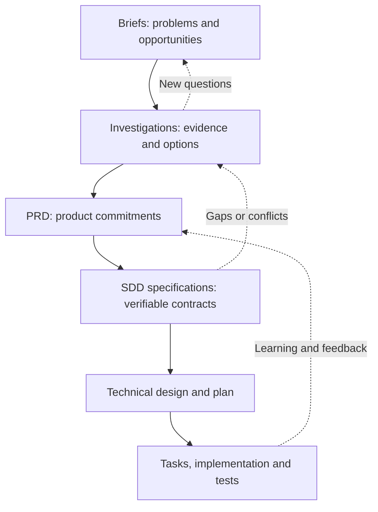
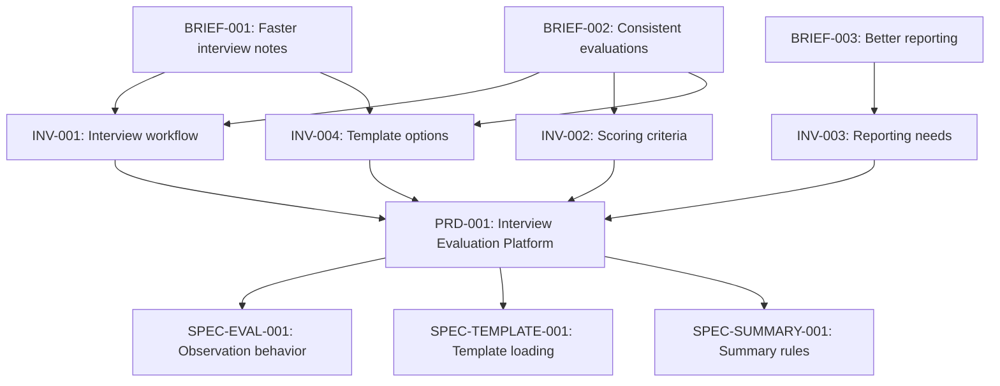

# From Ideas to Implementation: Briefs, Investigations, PRDs, and SDD Specifications

> **Purpose:** A practical guide to the different artifacts used in product discovery, product definition, Spec-Driven Development (SDD), and implementation—and how those artifacts relate to one another.
>
> **Core principle:** Documentation should preserve decisions, reduce uncertainty, and make requirements verifiable. The goal is **not** to produce more documents.

## 1. The big picture

The artifacts represent different **levels of decision-making**, not multiple ways to describe the same thing.

| Artifact | Primary question | What it produces | Main concern |
|---|---|---|---|
| **Brief** | What problem or opportunity is worth exploring? | A shared problem statement and desired outcome | **Why investigate?** |
| **Investigation / Discovery** | What do we know, what remains uncertain, and what options exist? | Findings, evidence, trade-offs, assumptions, and recommendations | **What should we learn or decide?** |
| **PRD — Product Requirements Document** | What must the product accomplish, for whom, and why? | Product scope, capabilities, user journeys, and success criteria | **What are we committing to deliver?** |
| **SDD Specification** | What exact observable behavior, rules, and contracts must the system satisfy? | Precise, testable requirements | **What must be true?** |
| **Technical Design / Plan** | How will the solution satisfy the specs? | Architecture and implementation decisions, dependencies, sequencing | **How will we build it?** |
| **Tasks / Tests** | What work must be executed and verified? | Actionable changes and verification results | **How do we deliver and prove it works?** |

A **conceptual** flow is:



**Important:** This is not a mandatory waterfall. Discovery may continue while specifications are being refined. A small change may require only a focused specification and a small plan.

## 2. Artifact definitions and boundaries

### 2.1 Brief — Define the problem

A Brief captures **why an idea deserves attention**. It should remain solution-agnostic when possible.

**Recommended contents**

- Title, ID, author/owner, and status.
- Context and problem/opportunity statement.
- Users or stakeholders affected.
- Business or user impact.
- Desired outcome and potential success signals.
- Known constraints and explicit assumptions.
- Questions requiring investigation.
- Links to related Briefs and prior findings.

**Example — `BRIEF-001: Faster Interview Notes`**

> Technical interviewers currently capture observations with inconsistent methods. Important evidence can be missed, and writing evaluations after the interview takes extra time. We want interviewers to record observations quickly without interrupting the conversation.

This brief **does not** need to choose React, define a database, or prescribe checkboxes as the solution.

**Boundary:** A Brief identifies a problem or opportunity; it does not approve a specific implementation.

### 2.2 Investigation — Reduce uncertainty

An Investigation (also called *Discovery*, *Research*, *Feasibility Study*, or a *Spike* when technical and time-boxed) answers a question before a commitment is made.

An Investigation can be **product-focused**, **user-focused**, **business-focused**, **technical**, or **cross-cutting**.

**Recommended contents**

- Investigation objective and decision to be supported.
- Related Briefs, PRDs, or Specs.
- Questions and hypotheses.
- Existing evidence and sources.
- Options considered and evaluation criteria.
- Findings, constraints, trade-offs, and risks.
- Assumptions classified as validated, unvalidated, or disproven.
- Open questions and recommendation.
- Outcome: proceed, refine, split, merge, defer, reject, or investigate further.

**Example — `INV-002: Configurable Interview Templates`**

Questions:

1. Are interview scripts consistent across roles?
2. What kinds of questions and evaluation criteria must be represented?
3. Would a JSON-based template be sufficient for an initial release?
4. Are template editors required for initial adoption?

*Illustrative, hypothetical findings:* Interview scripts differ by role; structured checklists and free-form notes are both needed; JSON-based templates may be sufficient for V1.

**Boundary:** Investigations inform decisions; they are not necessarily commitments. One investigation can rule out an idea or support multiple products.

### 2.3 PRD — Define the product commitment

A **Product Requirements Document (PRD)** consolidates selected problems, relevant evidence, and product decisions into a coherent definition of what should be delivered.

**Recommended contents**

- Product goal and user/business problem.
- Target users/personas and their jobs-to-be-done.
- Expected outcomes and success metrics.
- In-scope and out-of-scope capabilities.
- Functional requirements, ideally with stable IDs.
- Non-functional product expectations (accessibility, reliability, usability, privacy, etc.).
- Primary user flows and important edge cases.
- Product-level acceptance criteria.
- Dependencies, constraints, assumptions, and open decisions.
- Links to source Briefs/Investigations.

**Example — `PRD-001: Interview Evaluation Platform`**

| ID | Product requirement |
|---|---|
| `PRD-001-R01` | Interviewers can select an interview template. |
| `PRD-001-R02` | Templates contain exercises, evaluation objectives, and observable behaviors. |
| `PRD-001-R03` | Interviewers can mark the status of each observed behavior. |
| `PRD-001-R04` | Interviewers can add free-form notes beyond predefined checklist items. |
| `PRD-001-R05` | Interviewers can generate and edit an evaluation summary. |

**Illustrative V1 exclusions:** A visual template-authoring interface, automated candidate scoring, and applicant tracking system integration.

**Boundary:** The PRD defines the user-facing capabilities and product intent. It generally should **not** specify internal class structures, framework selection, storage schemas, or low-level algorithms unless they are genuine product constraints.

### 2.4 SDD Specification — Define verifiable system behavior

In **Spec-Driven Development (SDD)**, specifications serve as an explicit, testable contract for implementation. They translate the product requirements into detailed expected behavior and constraints.

A good spec answers questions such as:

- Exactly what happens when a user or system performs an action?
- Under which conditions must it happen?
- Which inputs and outputs are valid?
- How are errors and edge cases handled?
- Which invariants must always hold?
- Which interfaces/contracts must collaborating components respect?
- How can compliance be tested?

**Example — `SPEC-EVAL-001: Record Behavior Observation`**

> When an interviewer changes an observation status, the evaluation application **SHALL** record the new status for the selected behavior in the current evaluation.
>
> When that status changes, the application **SHALL NOT** delete existing free-form notes for the same behavior.
>
> When the evaluation summary is generated, the system **SHALL** include the latest recorded status and associated notes.

**Example scenario**

```gherkin
Given an interviewer has opened an interview evaluation
And the selected exercise contains three observable behaviors
When the interviewer marks two behaviors as observed
And marks one behavior as not observed
Then the evaluation contains all three statuses
And the generated summary reflects those statuses
```

This example avoids prescribing *how* state is stored. Persistence across browser refreshes, sessions, or devices should be specified separately **if the PRD commits to it**; do not silently assume those guarantees.

**Boundary:** A specification says what must be true and how to verify it, while leaving implementation flexibility where appropriate.

### 2.5 Platform Specifications versus Component Specifications

For a platform with multiple services, applications, or modules, specifications can be organized at different levels.

#### Platform Spec

Defines **system-wide contracts and boundaries**:

- Platform purpose, major capabilities, and responsibilities.
- Shared business invariants and constraints.
- Main domains and bounded contexts.
- Inputs, outputs, and integration contracts.
- Dependencies between components and external systems.
- Cross-cutting requirements: security, auditability, privacy, reliability, etc.
- Architecture decision references where relevant.

**Example:** The evaluation platform must load role-specific templates and associate every recorded observation with a specific evaluation and template version.

#### Component Spec

Defines **focused observable behavior within one component's responsibility**:

| Component | Example responsibility |
|---|---|
| Template Loader | Validate and load JSON template versions, returning defined errors for malformed data. |
| Evaluation Engine | Apply valid observation state changes and preserve related notes. |
| Interview UI | Display exercises and allow interviewers to change statuses and add notes. |
| Summary Generator | Produce a summary from recorded statuses and notes according to an output contract. |

**Rule:** Platform specs establish shared expectations; component specs refine them. Do not copy the same complete requirement into every component. Reference the upstream requirement and define only the component-specific contract.

### 2.6 Technical Design / Implementation Plan — Decide how

Technical Design and planning describe **the chosen approach to satisfying the specs**.

Typical contents:

- Architecture, component decomposition, interfaces, and data model.
- Technology choices and rationale.
- Implementation sequence and dependencies.
- Data migrations, compatibility, and rollout strategy.
- Design alternatives and Architecture Decision Records (ADRs).
- Test approach, operational impact, and risk mitigation.

**Example decisions:** Use React/TypeScript for the UI; define a versioned JSON schema for templates; separate template loading from evaluation state and summary generation.

Those are **illustrative decisions**, not things every product must do.

**Boundary:** Technical Design chooses implementation mechanisms. If changing a mechanism would not change the externally required behavior, it probably belongs in design rather than the behavioral spec.

### 2.7 Tasks and Tests — Execute and verify

Tasks make the plan actionable. Tests demonstrate that the result satisfies its contracts.

Example tasks:

- `TASK-001`: Define template schema and validation behavior.
- `TASK-002`: Implement observation state changes.
- `TASK-003`: Implement editing of free-form notes.
- `TASK-004`: Implement summary generation.
- `TASK-005`: Add tests for `SPEC-EVAL-001` scenarios.

Tasks should link to the specs they implement. Tests should link to the specs they verify.

## 3. Relationships are many-to-many, not strictly one-to-one

**Yes: multiple Briefs and multiple Investigations can converge into a single PRD.** This is often the natural outcome of discovery.



Other valid outcomes:

- **One Brief → many Investigations:** A broad problem requires user research, business analysis, and technical feasibility work.
- **Many Briefs → one Investigation:** Several complaints reflect the same underlying workflow problem.
- **One Investigation → many PRDs:** Research uncovers independent products or initiatives.
- **Many Briefs/Investigations → no PRD:** The opportunity is not viable, is deferred, or is already covered elsewhere.
- **Existing PRD → further Investigation:** New uncertainty arises during refinement or delivery.
- **One PRD → many Specs:** Different system domains or components require distinct, testable contracts.
- **One Spec → many Tasks and Tests:** Implementing and verifying a behavior requires work across components.

The PRD should be a **synthesis of selected decisions**, not a copy-paste compilation of everything learned in discovery.

## 4. Discovery and delivery: two different modes

| Discovery | Definition and delivery |
|---|---|
| Explores uncertainty | Establishes and fulfills commitments |
| Multiple competing ideas are welcome | Accepted scope must be explicit |
| Assumptions may be unresolved | Important assumptions need ownership or mitigation |
| Evidence can contradict earlier beliefs | Specs must be coherent and testable |
| Investigations can reject a direction | Changes require explicit impact assessment |

This separation does **not** mean rigid departments or handoffs. It means distinguishing **tentative knowledge** from **approved expectations**.

A useful decision point is: **Do we have enough confidence to commit to a product outcome and scope?**

If yes, create or update the PRD. If not, investigate the blocking uncertainty—or proceed with an explicitly bounded assumption and risk.

## 5. Traceability: connect the reasoning without duplicating documents

A traceable chain might look like this:

```text
BRIEF-002     Candidate evaluations are inconsistent
   |
   v
INV-002       Determine common evaluation criteria
   |
   v
PRD-001-R03   Interviewers record observed behavior status
   |
   v
SPEC-EVAL-001 Status changes must update the current evaluation
   |
   +--> DESIGN-001  Evaluation state and data model
   |
   +--> TASK-002    Implement observation state change
   |
   +--> TEST-001    Verify changes and note preservation
```

Suggested relationship types:

| Relationship | Meaning |
|---|---|
| `motivates` | A Brief explains why another artifact is needed. |
| `investigates` | An Investigation examines a problem or open question. |
| `provides-evidence-for` | Findings support or challenge a product decision. |
| `defines` | A PRD formalizes an intended product capability. |
| `refines` | A more detailed Spec clarifies a higher-level requirement. |
| `constrains` | A rule or platform contract limits an allowed solution. |
| `implements` | A task or code change fulfills a Spec. |
| `verifies` | A test demonstrates compliance with a Spec. |
| `supersedes` | An artifact or decision replaces an older one. |

**Avoid:** Unstructured links that give no indication of *why* two documents are connected.

### Lightweight Markdown metadata example

Each artifact may be a standalone Markdown file with optional YAML frontmatter:

```yaml
---
id: PRD-001
type: prd
title: Interview Evaluation Platform
status: approved
owner: product-team
source_briefs:
  - BRIEF-001
  - BRIEF-002
  - BRIEF-003
source_investigations:
  - INV-001
  - INV-002
  - INV-003
specifications:
  - SPEC-EVAL-001
  - SPEC-TEMPLATE-001
  - SPEC-SUMMARY-001
---
```

The exact schema is a convention, not a standard. IDs and links should remain stable even if filenames and folders change.

### One possible repository structure

```text
docs/
  discovery/
    briefs/
      BRIEF-001-faster-interview-notes.md
      BRIEF-002-evaluation-consistency.md
    investigations/
      INV-001-interview-workflow.md
      INV-002-template-feasibility.md
  product/
    prds/
      PRD-001-interview-evaluation-platform.md
  specs/
    platform/
      evaluation-platform.md
    components/
      SPEC-EVAL-001-observations.md
      SPEC-TEMPLATE-001-template-loading.md
      SPEC-SUMMARY-001-summary-generation.md
  design/
    DESIGN-001-technical-architecture.md
    adr/
  delivery/
    tasks/
    test-plans/
```

This is an organizational example, **not** a requirement to put all artifacts into a single repo. A central knowledge base, multiple repositories, or a hybrid setup can work if references and ownership are clear.

## 6. A practical end-to-end example

### Starting point: three independent problems

1. **`BRIEF-001`:** Taking interview notes is slow and distracting.
2. **`BRIEF-002`:** Different interviewers evaluate the same capabilities inconsistently.
3. **`BRIEF-003`:** Hiring managers cannot easily compare evidence from evaluations.

### Discovery: four questions to investigate

1. **`INV-001`:** What does the interviewer's actual workflow look like?
2. **`INV-002`:** Which criteria can be standardized, and which vary by role?
3. **`INV-003`:** What information should a useful final evaluation contain?
4. **`INV-004`:** Is loading templates from JSON sufficient for V1?

### Product decision

The findings may support **one PRD** for an *Interview Evaluation Platform*, rather than three disconnected features. The PRD sets V1 scope and defers a template-management UI.

### SDD definition

- **Platform Spec:** Overall evaluation lifecycle, template/version association, shared data invariants.
- **Template Loader Spec:** Accepted template structure, validation failures, version handling.
- **Evaluation Spec:** Allowed status transitions, notes behavior, consistency rules.
- **Summary Spec:** Required content and formatting-related output rules.

### Technical plan and delivery

Choose technologies, define component boundaries, implement small tasks, and test each accepted scenario.

**Result:** Multiple discovery artifacts converge into a coherent product while remaining individually reusable and traceable.

## 7. Choosing the right amount of documentation

Not every change warrants the full set of artifacts.

| Situation | Minimum reasonable artifacts |
|---|---|
| New idea with unclear value | Brief |
| High uncertainty or competing approaches | Brief + targeted Investigation(s) |
| New product or major feature | PRD + relevant Specs + Plan; link relevant discovery evidence |
| Small feature in an existing product | Update existing PRD if scope changes; add focused Spec/Plan |
| Bug fix | Existing expected behavior or a focused Spec + fix and regression test |
| Internal refactor | Existing behavior contract + technical design/tasks and verification |
| Cross-platform capability | Platform Spec + affected Component Specs + rollout plan |

If a stage does not add clarity, **skip the ceremony, not the decision**.

### Three questions before creating another document

1. **Is this a new question or just a more detailed version of an existing answer?**
2. **Does this artifact have its own owner, decision, or lifecycle?**
3. **Can we link to existing knowledge instead of repeating it?**

## 8. Ownership, status, and decision gates

A simple lifecycle helps separate preliminary ideas from approved expectations.

| Artifact | Example statuses | Promotion or completion signal |
|---|---|---|
| Brief | draft → ready for investigation → merged/deferred/closed | The opportunity and open questions are understandable. |
| Investigation | planned → active → completed/inconclusive | Findings, evidence quality, and recommendation are recorded. |
| PRD | draft → review → approved → superseded | Product scope, outcomes, exclusions, and owners are accepted. |
| Spec | draft → reviewed → accepted → superseded | Behavior is unambiguous enough to implement and verify. |
| Design | proposed → accepted → revised | Trade-offs and chosen implementation direction are explicit. |
| Tasks | planned → in progress → verified → done | Implemented behavior passes the required checks. |

Use statuses that suit the team. A document being **completed** does not imply its proposal was approved. For instance, a completed Investigation can recommend **not proceeding**.

### Assumptions, risks, and unknowns

For every artifact, distinguish:

- **Fact:** Supported by evidence or an authoritative source.
- **Assumption:** Believed but not yet validated; name its owner and impact.
- **Decision:** Explicit choice, with rationale and date.
- **Open question:** Requires investigation or product clarification.
- **Out of scope:** Deliberately excluded from this artifact or release.

An assumption should not silently become a requirement when an AI agent generates subsequent artifacts.

## 9. PRD versus Spec: how to avoid duplication

Use this simple test:

- If it describes a **user goal, product capability, scope, or success measure**, it primarily belongs in the **PRD**.
- If it describes **precise conditions, inputs, outputs, invariants, edge cases, or acceptance scenarios**, it primarily belongs in an **SDD Spec**.
- If it explains **a technology, algorithm, architecture, component structure, or deployment choice**, it primarily belongs in **Technical Design**.

**Example:**

| Layer | Statement |
|---|---|
| PRD | Interviewers can add notes to any evaluation objective. |
| Spec | When notes are edited, a status change SHALL NOT overwrite the notes for that objective. |
| Design | Persist objective notes in a versioned evaluation data structure. |
| Test | Change a status after writing a note; verify the note remains unchanged. |

The same business intent flows through the chain, but each artifact adds a **different kind of information**.

## 10. SDD tools and naming conventions

Tools such as **GitHub Spec Kit** and **OpenSpec** use their own workflows and artifact names. A framework's *specification* or *proposal* may cover material that another organization places in a PRD or Brief.

Treat the concepts in this guide as the **logical information model**, not a mandatory mapping to specific CLI commands or filenames:

- **Discovery:** Why are we considering this, and what have we learned?
- **Product definition:** What are we committing to deliver?
- **Behavioral contracts:** What must the system do and what conditions must hold?
- **Design and execution:** How will we implement, test, and release it?

Map these concepts into the conventions of the chosen framework without maintaining duplicate, conflicting sources of truth.

> **Terminology note:** **PRD** means *Product Requirements Document*. **SDD** means *Spec-Driven Development*. **Spec** is short for *specification*. Terms such as “SPRD” are not necessary for this model unless a particular organization explicitly defines one.

## 11. Recommended operating principles

1. **Start from the problem, not the solution.** A Brief should leave room for discovery.
2. **Allow many-to-many relationships.** Do not impose one Brief → one Investigation → one PRD.
3. **Separate evidence from commitment.** An investigation finding is not automatically a product requirement.
4. **Synthesize, don't concatenate.** PRDs consolidate accepted product decisions; they don't reproduce every research note.
5. **Write verifiable specs.** Make conditions, responses, and exceptions explicit.
6. **Separate contracts from implementation.** Decide *what must be true* before locking in *how it is done*.
7. **Use stable IDs and typed links.** Preserve traceability from problems to tests.
8. **Keep one source of truth per decision.** Reference shared rules rather than copying them everywhere.
9. **State assumptions and exclusions.** Especially when generating documents through AI agents.
10. **Scale the process to the risk.** A narrow bug fix does not need the same ceremony as a new platform.

## 12. Short reference summary

```text
BRIEF          = Why is this problem worth considering?
INVESTIGATION  = What do we know, and what must we find out?
PRD            = What product outcome and capabilities will we deliver?
PLATFORM SPEC  = What shared system-level rules and contracts apply?
COMPONENT SPEC = What must a particular component do?
TECH DESIGN    = How will we implement the required behavior?
TASKS          = What work will we perform?
TESTS          = How will we prove the contract is satisfied?
```

**Final takeaway:** Many Briefs and Investigations may inform one PRD; one Investigation may inform several PRDs; and a PRD may result in many platform/component specifications. The artifacts are a **connected knowledge graph of problems, evidence, decisions, contracts, and verification**, not a rigid series of documents.
